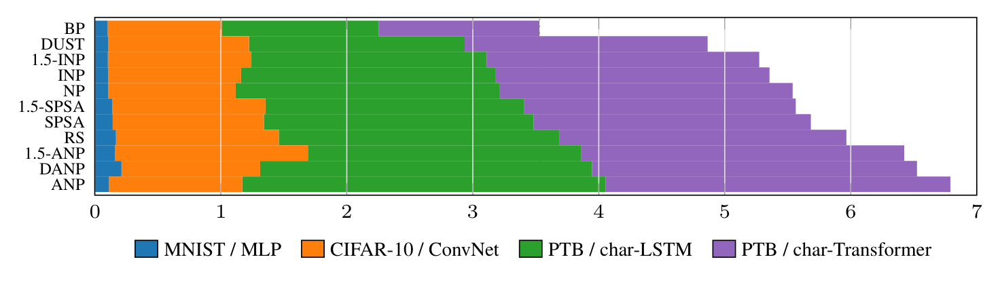
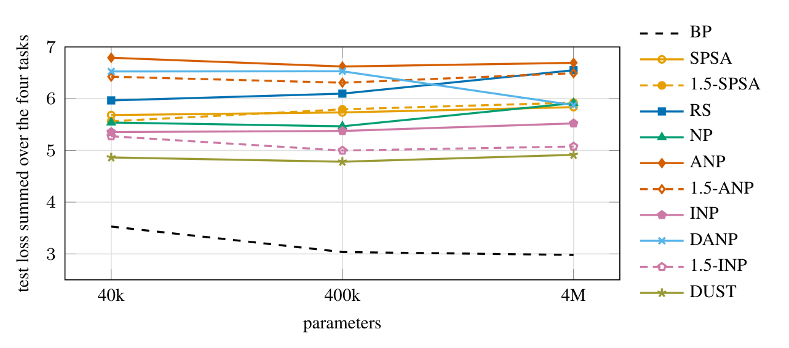

# A ZOO Deep Learning Survey

**Zero-order optimization (ZOO)** trains a network from loss evaluations alone, without back-propagating
errors. It is the natural training rule for neuromorphic and analog hardware, non-differentiable systems,
biologically plausible learning and memory-constrained training. Many ZOO rules exist, but they are rarely
compared under one budget on the same networks. This repository does that: **twelve backprop-free rules
against backpropagation on four architectures**, with the same forward passes per step, one GPU-hour, the
same Adam update and three seeds.

**[Read the paper (PDF)](paper/zoo_survey_final.pdf)** · [LaTeX source](paper/) ·
[Blog post](https://fchaubard.github.io/zoo_survey.html) · [Protocol](PROTOCOL.md)



*Figure 1. Test loss at the best validation checkpoint, summed over the four tasks (lower is better), with
each task's contribution stacked; mean over three seeds. BP is the backpropagation reference (3.53).
Forward-forward is omitted because its readout loss is not comparable.*

## Findings

- **DUST is the best probe method.** It has the lowest summed loss (4.86, against 5.27 for 1.5-INP and 5.36
  for iterative node perturbation) and leads both language models: 2.47 and 2.78 bits per character on the
  LSTM and the Transformer, against 1.80 and 1.84 for backpropagation.
- **On images, node perturbation is close to backprop on MNIST, not on CIFAR-10.** The best node-perturbation
  rules reach 96.7–97.0 % on MNIST (backprop 97.0 %) but at most 65 % on CIFAR-10 (backprop 69.2 %).
- **The step size decides, not the probe scale.** At ε = 10⁻⁴, eight of the ten protocol rules improve on
  both image tasks, and the weight-space rules (SPSA, random search) close about half of their gap.
- **Identity-path credit is the best rule on the Transformer.** It measures the top-layer error exactly and
  sends it down the residual path, with one forward pass per step: 2.56 bits per character at 40k
  parameters, and its gap to backprop narrows with size, from 0.72 to 0.44 bits per character at 4M. It
  needs a residual network, so it runs on the Transformer only.
- **Curvature preconditioning ("1.5-order") does not help.** 1.5-SPSA's curvature factor is inert under Adam
  and does not help under SGD. 1.5-ANP's gains on the sequence models survive setting its curvature exponent
  to zero. Added to DUST, it lowers the alignment with the true gradient on all four tasks in a CPU check
  (Appendix C).
- **More parameters do not close the gap.** At 10× and 100× the size, DUST and 1.5-INP stay the two best
  probe rules, but the gap to backpropagation widens and the step size selected at 40k has to shrink.

## Main result

Best-validation-checkpoint test accuracy or bits per character, mean over three seeds (Table 1 of the paper,
with standard deviations and losses). Score = test loss summed over the four tasks; lower is better.

| Method | MNIST / MLP acc. | CIFAR-10 / ConvNet acc. | PTB / char-LSTM bits/char | PTB / char-Transformer bits/char | Score |
|---|---:|---:|---:|---:|---:|
| Backprop (reference) | 97.0 % | 69.2 % | 1.80 | 1.84 | 3.53 |
| **DUST** | 96.9 % | 60.7 % | **2.47** | **2.78** | **4.86** |
| 1.5-INP | **97.0 %** | 60.0 % | 2.69 | 3.12 | 5.27 |
| INP | 96.9 % | 63.5 % | 2.91 | 3.14 | 5.36 |
| NP | 96.7 % | **65.0 %** | 3.02 | 3.36 | 5.54 |
| 1.5-SPSA | 95.9 % | 56.7 % | 2.96 | 3.11 | 5.56 |
| SPSA | 95.8 % | 57.8 % | 3.09 | 3.17 | 5.68 |
| Random search | 94.9 % | 53.7 % | 3.22 | 3.28 | 5.97 |
| 1.5-ANP | 95.7 % | 46.2 % | 3.13 | 3.70 | 6.42 |
| DANP | 94.0 % | 63.0 % | 3.80 | 3.72 | 6.53 |
| ANP | 96.6 % | 63.3 % | 4.16 | 3.95 | 6.79 |
| Forward-forward | 59.7 % | 33.9 % | 3.78 | 4.23 | – |
| Identity-path credit | – | – | – | 2.56 | – |

Bold: best backprop-free rule per column. Identity-path credit runs on the Transformer only and has no score.

**Model size** (one seed per point; Figure 2 of the paper). Summed test loss at 40k / 400k / 4M parameters:
backprop 3.53 / 3.04 / 2.98, DUST 4.86 / 4.78 / 4.91, 1.5-INP 5.27 / 5.00 / 5.08, INP 5.36 / 5.38 / 5.52.
Transformer test loss of identity-path credit: 1.78 / 1.39 / 1.37, against backprop's 1.28 / 1.06 / 1.07.



## Protocol

| | |
|---|---|
| Tasks | MLP on MNIST, ConvNet on CIFAR-10, character-level LSTM and Transformer on Penn Treebank; ≈40k parameters each (also 400k and 4M) |
| Budget | 1 GPU-hour per run (RTX 5090), training time only; evaluation every minute |
| Passes | 16 forward passes per step for the probe methods (17 for the 1.5-order rules); backprop takes one forward and one backward |
| Update | Adam (β = 0.9, 0.99) on every estimate, learning rate = probe scale = ε |
| Selection | ε screened over five values per method and task, then three seeds at the selected ε; best validation checkpoint reported |

The full protocol is in [PROTOCOL.md](PROTOCOL.md) and Section 4 of the paper.

## Methods

| Key | Method | Passes / step |
|---|---|---|
| `bp` | Backpropagation (reference) | 1 + backward |
| `spsa` | SPSA, Gaussian antithetic pairs | 16 |
| `spsa15` | 1.5-SPSA: SPSA with a three-point curvature preconditioner | 17 |
| `rs` | Random search, best of 15 probes (`rsj`: direct-jump variant) | 16 |
| `np` | Node perturbation | 16 |
| `anp` | Activity-based node perturbation | 16 |
| `inp` | Iterative node perturbation (one layer per pass) | 16 |
| `danp` | Decorrelated activity-based node perturbation | 16 |
| `anp15` | 1.5-ANP: activity perturbation with curvature preconditioning | 17 |
| `inp15` | 1.5-INP: 1.5-ANP's estimator with INP's layer-wise probing (new) | 17 |
| `dust` | DUST (Q Labs, 2026), ported to all four models | 16 |
| `ipc` | Identity-path credit (Noise speedrun, Q Labs, 2026), Transformer only | 1 |
| `ff` | Forward-forward | 2 |
| `dust15` | 1.5-DUST: DUST with 1.5-ANP's estimator (negative result, Appendix C) | 17 |

Every method lives in one file under [`zoo/optimizers/`](zoo/optimizers); the paper's Appendix A gives each
definition.

## Repository layout

```
paper/              LaTeX source (main.tex, figures/ in TikZ, tables/ generated), zoo_survey_final.pdf
zoo/perturb.py      perturbable layers and the global forward "mode" every optimizer drives
zoo/models.py       the four models at three sizes (build_model, SIZES)
zoo/optimizers/     one file per method family; get_optimizer(name, model, lr, task_kind, n_classes, ...)
zoo/data.py         MNIST / CIFAR-10 / PTB-char, resident on the device; python -m zoo.data --download-all
zoo/train.py        one run: timed training loop, evaluation every N seconds, results JSON (+ wandb)
zoo/sweep.py        job lists over a GPU pool (resumable);  zoo/status.py  quick tables
scripts/            collect_stage2.py (every table and figure of the paper), gradient_alignment.py,
                    dust15_alignment.py, readme_figures.py, setup_remote.sh, launch_sweep.sh, ...
jobs/               the job lists of every stage (one zoo.train argument line per run)
results/            stage 1 screening (one seed per epsilon)
results_v2/         stage 2: three seeds at the selected epsilon, plus DUST, 1.5-INP, IPC and follow-ups
results_scale/      400k and 4M parameters
results_bp/, results_decouple/, results_15/, results_align*/, results_supp/, results_dust15/
                    backprop reference, untied probe scale, 1.5-order rules under their own recipe,
                    gradient alignment, short backprop runs, the 1.5-DUST check
logs/               sweep logs
```

Every run's JSON holds its configuration, its per-minute history (train / validation / test loss and
accuracy) and its final result; every run is also on Weights & Biases (project `zoo-survey`).

## Reproduce

```bash
python -m venv .venv && source .venv/bin/activate
pip install -r requirements.txt
python -m zoo.data --root ./data --download-all      # MNIST, CIFAR-10, PTB (cached under data/)
python -m pytest tests -q                            # CPU, no network
```

One run (the budget counts only time inside `opt.step`):

```bash
python -m zoo.train --task transformer_ptb --opt dust --lr 0.001 --budget 3600 --eval-every 60 \
    --seed 0 --out results_v2 --no-wandb
```

A job list over 8 GPUs (resumable; one log per run under `--logdir`):

```bash
bash scripts/setup_remote.sh                         # fresh Ubuntu + CUDA box: dependencies, data, GPU list
python -m zoo.sweep --jobs jobs/stage2.txt --gpus 0,1,2,3,4,5,6,7 --logdir runs_v2
```

Tables, figures and the paper:

```bash
python scripts/collect_stage2.py --align results_align_gpu   # regenerates paper/tables and paper/data
cd paper && make                                              # main.pdf (pdflatex + bibtex)
```

Ablation flags of `zoo.train` (each recorded in the run name): `--sigma` (probe scale untied from the
learning rate), `--passes` (forward-pass budget), `--size m|l` (400k / 4M parameters), `--alpha` and
`--lam` (curvature exponent and floor of the 1.5-order rules), `--loss64`, `--optim sgd`, `--weight-decay`,
`--tf32`, `--seed`.

## Citation

```bibtex
@misc{chaubard2026zoo,
  title        = {A {ZOO} Deep Learning Survey},
  author       = {Chaubard, Francois},
  year         = {2026},
  howpublished = {\url{https://github.com/Fchaubard/zero_order_optimization_DL_survey}}
}
```

MIT License. DUST and identity-path credit are ported from the MIT-licensed reference code of Q Labs
([qlabs-eng/dust](https://github.com/qlabs-eng/dust), [qlabs-eng/noise](https://github.com/qlabs-eng/noise)).
